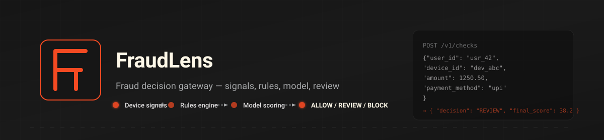
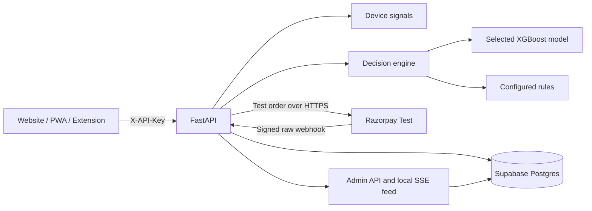

<div align="center">



<br />


**A fraud decision gateway for controlled demos.** Register device signals, score a payment with configurable rules and a selected model, get a clear ALLOW/REVIEW/BLOCK decision, and continue to Razorpay Checkout only when eligible. Includes an admin review queue with live SSE feed.

[Flow](#-fraud-decision-flow) · [Signals](#-device-signals) · [Decisions](#-allowreviewblock-decisions) · [Review Queue](#-reviewer-queue) · [Razorpay Integration](#-razorpay-test-mode-integration) · [Dashboard](#-admin-dashboard) · [Architecture](#-architecture) · [Tech Stack](#-tech-stack) · [API Contract](#-api-contract) · [Setup](#-macos-zsh-setup) · [Supabase Migrations](#-supabase-migrations) · [Deployment](#-render-deployment) · [Security](#-security-and-data-handling) · [Limitations](#-honest-limitations)

</div>

---

## 🔄 Fraud Decision Flow



1. **Collect signals** — The client posts a stable install ID, device context, and optional location to `POST /v1/signals`. Payment instrument details stay with Razorpay.
2. **Score the check** — `POST /v1/checks` combines the live model score (0–100) with the rule score (0–100) using weights `0.6 × ML + 0.4 × Rules`. A hard rule forces at least REVIEW.
3. **Act on the outcome** — `ALLOW` creates a Razorpay test order. `REVIEW` waits for admin approval. `BLOCK` stops before Checkout.
4. **Webhook updates** — Razorpay posts signed events to `/v1/webhooks/razorpay`; the gateway updates payment status.
5. **Admin review** — Reviewers see pending cases, resolve them, and create labelled feedback for model evaluation.

---

## 📡 Device Signals

`POST /v1/signals` registers a device for a merchant user. The same shape is sent from web, mobile PWA, and browser extension.

| Field | Type | Constraints |
|-------|------|-------------|
| `device_id` | string | Merchant-scoped install ID, 1–160 chars |
| `user_id` | string | Merchant user ID, 1–160 chars |
| `platform` | enum | `web` \| `mobile` \| `extension` |
| `user_agent` | string | 1–512 chars |
| `screen` | object | `width` 1–16384, `height` 1–16384, `pixel_ratio` 0–10 |
| `timezone` | string | IANA zone, 1–64 chars |
| `language` | string | BCP 47, 1–35 chars |
| `lat`, `lon` | number | Optional, paired, WGS84 bounds |

**Response** returns `device_id`, `first_seen`, `last_seen`, and a `trust_score` (0–100). The trust score increases with device age and clean decisions.

**Collection spec** — Generate a random merchant-scoped install ID and persist it in platform local storage. Do not use canvas, audio, font, or invasive fingerprinting. Do not use a cross-merchant identifier. Collect `navigator.userAgent`, screen dimensions, `devicePixelRatio`, `Intl.DateTimeFormat().resolvedOptions().timeZone`, `navigator.language`. Request location permission only when the merchant UX requires it; send coarse coordinates.

---

## ⚖️ ALLOW/REVIEW/BLOCK Decisions

`POST /v1/checks` returns a decision with scores, reasons, and a check ID.

```json
{
  "check_id": "00000000-0000-0000-0000-000000000001",
  "decision": "REVIEW",
  "final_score": 38.2,
  "ml_score": 12.5,
  "rule_score": 77,
  "reasons": [
    { "rule": "STRUCTURING", "detail": "3 transactions between 90000 and 100000 within 24 hours", "weight": 35 }
  ],
  "model_version": "xgb_live_v1",
  "ml_factors": [
    { "feature": "amount", "contribution": 0.2 }
  ],
  "latency_ms": 24
}
```

**Scoring formula**
- `final_score = round(ml_score × 0.6 + rule_score × 0.4, 2)`
- Both scores are on a 0–100 scale
- `ml_factors` are raw XGBoost margin contributions (positive = higher fraud probability)

**Thresholds**
| Decision | Condition |
|----------|-----------|
| `ALLOW` | `final_score < 30` and no hard rule |
| `REVIEW` | `30 ≤ final_score < 60` or any hard rule triggered |
| `BLOCK` | `final_score ≥ 60` |

**Idempotency** — Provide an `Idempotency-Key` header. Reusing the same key for the same merchant returns the stored check without rescoring.

---

## 🧱 Configurable Rules Engine

Eleven rules, all weights and thresholds in `backend/rules_config.json`. No code changes needed to tune.

| Rule | Weight | Trigger Summary | Hard |
|------|--------|-----------------|------|
| `HIGH_AMOUNT` | 25 | Amount above ₹100,000 | No |
| `STRUCTURING` | 35 | 3+ transactions ₹90K–₹100K in 24 hours | **Yes** |
| `VELOCITY` | 30 | 4+ checks in 15 minutes | No |
| `IMPOSSIBLE_TRAVEL` | 40 | >1000 km/h over ≥50 km | **Yes** |
| `NEW_DEVICE` | 15 | Device not in user's check history | No |
| `ODD_HOUR` | 10 | Local device time 00:00–04:59 | No |
| `SHARED_DEVICE` | 25 | Device linked to 3+ users | No |
| `FAILED_PAYMENT_BURST` | 30 | 3+ failed payments in 10 minutes | No |
| `AMOUNT_SPIKE` | 30 | Amount > 5× mean of up to 20 prior checks (min 5) | No |
| `NEW_USER_HIGH_VALUE` | 20 | First check above ₹50,000 | No |
| `GEO_DEVICE_MISMATCH` | 20 | Timezone/location heuristic (disabled by default) | No |
| `TRUSTED_DEVICE_DISCOUNT` | -10 | Device ≥30 days old with 5 clean decisions | No |

Rules auto-discover from `backend/services/rules/` via `registry.py`. Each rule receives a `RuleContext` with user history, device info, and failed-payment counts from a Supabase RPC.

---

## 🧠 Model Scoring

Two XGBoost models, selectable via `MODEL_VERSION` environment variable.

| Model | Version | Features | Format | Use Case |
|-------|---------|----------|--------|----------|
| **Live** | `xgb_live_v1` | 24 computable features (amount, velocity, device age, distance, speed, payment method one-hots) | joblib (`.pkl`) | Primary — features available at inference |
| **Legacy** | `xgb_creditcard_v1` | 30 PCA features (V1–V28 + scaled amount + scaled time) | XGBoost JSON + scaler | Fallback only — PCA features unavailable live |

**Training** — `ml/src/train_live.py` generates synthetic data (or uses PaySim if present), trains with `XGBClassifier`, emits `backend/models/xgb_live_v1.pkl` and `ml/reports/live_v1.json` with metrics.

**Reported synthetic metrics** (not real-world performance):
- Precision: 0.910, Recall: 0.963, F1: 0.936
- ROC-AUC: 0.999, PR-AUC: 0.991, FPR: 0.0025
- 30,000 rows, 2.5% fraud rate, stratified 75/25 split

**SHAP explanations** — `ml_factors` returns top 5 feature contributions per prediction.

---

## 👥 Reviewer Queue

Admin endpoints require `Authorization: Bearer <ADMIN_TOKEN>`.

| Endpoint | Purpose |
|----------|---------|
| `GET /v1/admin/reviews?status=pending` | List pending/reviewed checks with scores and reasons |
| `POST /v1/admin/reviews/{check_id}` | Resolve a review: `{"outcome": "approve\|reject", "reviewer": "analyst-1", "note": "..."}` |
| `GET /v1/admin/stats` | Decision counts, rule triggers, latency, hourly totals |
| `GET /v1/admin/evaluation` | Confusion matrix and precision/recall/FPR on labelled cases |
| `GET /v1/admin/feed` | SSE stream of new checks (`event: check`, 15s keepalive) |

**Review resolution** — `approve` creates a `legit` feedback label; `reject` creates `fraud`. Both source `reviewer`. A check can be resolved once. Approved `REVIEW` checks become eligible for Razorpay order creation.

**SSE feed** — In-process, single-instance, no replay buffer after disconnect. Intended for one Render instance.

---

## 💳 Razorpay Test Mode Integration

| Endpoint | Purpose |
|----------|---------|
| `POST /v1/payments/order` | Create a test order for an `ALLOW` or approved `REVIEW` check |
| `POST /v1/payments/verify` | Verify Checkout HMAC callback (`razorpay_order_id`, `razorpay_payment_id`, `razorpay_signature`) |
| `POST /v1/webhooks/razorpay` | Receive signed events: `order.paid`, `payment.authorized`, `payment.captured`, `payment.failed` |

**Flow** — Merchant creates order only after an eligible check. Client opens Razorpay Checkout with returned `order_id`, `amount` (paise), and `key_id` (public). Checkout posts verification to `/v1/payments/verify`. Webhooks advance payment status independently.

**Test mode only** — `RAZORPAY_KEY_ID` must start with `rzp_test_`. See `backend/RAZORPAY_TESTING.md` for test card/UPI values, local webhook signing, and tunnel instructions.

**Implementation** — Uses `httpx` (no Razorpay SDK). HMAC-SHA256 verification on webhook raw body. Duplicate events acknowledged with `"duplicate": true`.

---

## 📊 Admin Dashboard

Next.js 16 App Router, React 19, TypeScript, Lucide React.

**Pages**
- `/` — Public landing with animated hero
- `/demo` — Merchant workspace (requires merchant session)
- `/admin` — Reviewer workspace (requires admin session)
- `/access` — Role gate

**Admin features**
- Overview: stats cards, 24-hour activity chart, top triggered rules, latency percentiles
- Reviews: paginated queue with filter (pending/reviewed/all), inline resolve dialog with reviewer name and note
- Evaluation: labelled-case confusion matrix, precision, recall, false positive rate
- Live feed: SSE stream with auto-refreshing stats

**Session** — HTTP-only cookies, role `merchant` or `admin`. No JWT in localStorage.

---

## 🏗️ Architecture

```
fraudlens/
├── backend/                    # FastAPI application
│   ├── main.py                 # App, middleware, routers, health
│   ├── routes/                 # predict, checks, payments, signals, admin, history, stats
│   ├── services/
│   │   ├── decision_engine.py  # Score combination, decision resolution
│   │   ├── rule_service.py     # Rule evaluation orchestration
│   │   ├── rules/              # 11 rule modules + base + registry
│   │   ├── model_service.py    # XGBoost loading, prediction, SHAP
│   │   ├── live_features.py    # 24 live features for xgb_live_v1
│   │   ├── check_service.py    # /v1/checks business logic
│   │   ├── admin_service.py    # Review queue, resolution, stats, eval
│   │   ├── live_feed.py        # In-process SSE publisher
│   │   ├── db.py               # Supabase client, transaction CRUD
│   │   ├── auth.py             # Merchant/Admin auth, rate limiting
│   │   ├── rate_limit.py       # In-memory token bucket (per-process)
│   │   ├── config.py           # Pydantic Settings from .env
│   │   └── rules_config.py     # Loads rules_config.json
│   ├── schemas.py              # Pydantic models (strict validation)
│   ├── rules_config.json       # Rule weights, thresholds, scoring
│   ├── models/                 # Model artifacts (gitignored)
│   ├── tests/                  # 11 test files
│   ├── requirements.txt
│   ├── render.yaml
│   └── RAZORPAY_TESTING.md
│
├── frontend/                   # Next.js 16 application
│   ├── app/                    # Pages, API gateway proxy, SSE proxy
│   ├── components/             # Dashboard, merchant demo, lens visual, badges
│   ├── lib/                    # Typed API client, server API, session, types
│   ├── tests/                  # Vitest + React Testing Library
│   └── package.json
│
├── ml/                         # Machine Learning pipeline
│   ├── src/train_live.py       # Trains xgb_live_v1 (synthetic or PaySim)
│   ├── src/train.py            # Legacy credit-card model training
│   ├── src/preprocess.py       # Legacy feature engineering
│   ├── src/explain.py          # SHAP explanations
│   ├── src/rule_engine.py      # Rule evaluation for training data
│   ├── notebooks/              # EDA, preprocessing, training notebooks
│   ├── models/                 # Trained artifacts
│   ├── reports/live_v1.json    # Training metrics report
│   └── requirements.txt
│
├── scripts/                    # Operational utilities
│   ├── create_merchant.py      # Creates merchant, prints API key once
│   ├── simulate_traffic.py     # 7 demo scenarios
│   ├── traffic_client.py       # HTTP client for simulations
│   ├── smoke_test.py           # Post-deploy health check
│   └── send_test_webhook.py    # Local webhook testing
│
├── docs/
│   └── api-contract.md         # Complete frontend handoff document
│
└── README.md
```

**Data flow for `/v1/checks`**
1. Rate limit (60 checks/min per merchant + IP)
2. Idempotency lookup
3. Supabase RPC `check_context` loads device, user history, device decisions, failed payments
4. Build 24 live features from history and current request
5. Model prediction with SHAP factors
6. Rule evaluation via auto-discovered registry
7. Score combination and decision resolution
8. Persist check row, publish to SSE feed, return response

---

## 🧰 Tech Stack

| Layer | Technology |
|-------|------------|
| **API** | FastAPI 0.115, Uvicorn, Pydantic 2, Pydantic Settings |
| **Database** | Supabase (PostgreSQL), RLS enabled, service key server-only |
| **ML** | XGBoost 2.1, scikit-learn 1.5, joblib, SHAP 0.46 |
| **Payments** | Razorpay Test Mode via httpx 0.27 |
| **Frontend** | Next.js 16 (App Router), React 19, TypeScript 5.8, Lucide React |
| **Styling** | CSS modules, CSS variables, no Tailwind |
| **Testing** | pytest 8.3 (backend), Vitest 5.1 + React Testing Library (frontend) |
| **Deployment** | Render Free Web Service, `render.yaml` |
| **CI** | GitHub Actions (not configured in repo) |

---

## 📄 API Contract

The complete frontend handoff document is at `docs/api-contract.md`. It covers:

- Authentication headers (`X-API-Key`, `Idempotency-Key`, `Authorization`, `X-Razorpay-Signature`)
- Health, signals, decision check, payments, webhooks
- Admin endpoints (reviews, stats, evaluation, SSE feed)
- Legacy endpoints (`/predict`, `/history`, `/stats`)
- Error format with `X-Request-ID` and error codes
- Client signal collection specification for web, mobile, extension

All amounts on checks are INR rupees. Razorpay order amounts are paise.

---

## 💻 macOS Zsh Setup

```zsh
# 1. Clone and enter
git clone https://github.com/QuantumSenpai/fraudlens.git
cd fraudlens

# 2. Python environment (conda recommended)
conda create -n fraudenv python=3.11 -y
conda activate fraudenv

# 3. Backend dependencies
pip install -r backend/requirements.txt

# 4. Train the live model (synthetic data)
python ml/src/train_live.py --synthetic-rows 30000

# 5. Frontend dependencies
cd frontend
npm install
cd ..

# 6. Configure environment
cp backend/.env.example backend/.env
# Edit backend/.env with your Supabase and Razorpay test credentials
# Required: SUPABASE_URL, SUPABASE_KEY, RAZORPAY_KEY_ID, RAZORPAY_KEY_SECRET,
# RAZORPAY_WEBHOOK_SECRET, ALLOWED_ORIGINS, ADMIN_TOKEN, MODEL_VERSION=xgb_live_v1

# 7. Apply Supabase migrations (see Supabase Migrations section)
# 8. Create a merchant
python scripts/create_merchant.py --name "FraudLens Demo"
# Save the printed API key — it is shown once

# 9. Run locally
# Terminal 1: Backend
cd backend
python -m uvicorn main:app --reload --port 8000 --no-proxy-headers

# Terminal 2: Frontend
cd frontend
npm run dev
# Open http://localhost:3000
```

**Demo traffic** (requires `FRAUDLENS_API_KEY` env var with merchant key):
```zsh
python scripts/simulate_traffic.py --scenario structuring --platform web
python scripts/simulate_traffic.py --scenario impossible_travel --platform mobile
python scripts/simulate_traffic.py --scenario shared_device --platform extension
```

Scenarios: `normal`, `structuring`, `velocity`, `impossible_travel`, `shared_device`, `night_high_value`, `all`.

**Backend tests**:
```zsh
cd backend
python -m pytest -q tests
```

**Frontend tests**:
```zsh
cd frontend
npm run test
```

---

## 🗄️ Supabase Migrations

Apply migrations in this order from the `migrations/` directory (not in repo root):

1. `001_init.sql` — Core tables: merchants, devices, device_users, checks, orders, payments, reviews, webhooks, transactions
2. `003_device_signals.sql` — Device trust score, last_seen updates
3. `004_check_context_rpc.sql` — `check_context` RPC for decision engine
4. `005_reviews.sql` — Reviews table and `resolve_review` RPC
5. `006_admin_aggregates.sql` — `admin_stats` and `admin_evaluation` RPCs
6. `007_webhooks.sql` — Webhook event storage
7. `008_idempotency.sql` — Unique constraints for idempotency keys
8. `009_indexes.sql` — Performance indexes

Migration `002` is an optional manual merchant seed.

**RLS** — Enabled on all tables. No public policies. The server uses the service role key. Never expose `SUPABASE_KEY` to the browser.

**Local development** — Use Supabase CLI or a cloud project. The backend expects the service role key in `SUPABASE_KEY`.

---

## 🚀 Render Deployment

`backend/render.yaml` defines the service.

**Deploy steps**
1. Apply Supabase migrations and create a merchant. Keep the service key and merchant key private.
2. Connect the Git repository to Render, select branch `main`.
3. Create a **Web Service**, choose Python, **Free** instance.
4. Root Directory: `backend`
5. Build Command: `pip install -r requirements.txt`
6. Start Command: `uvicorn main:app --host 0.0.0.0 --port $PORT`
7. Add environment variables in Render dashboard (use secret fields for secrets):

| Variable | Value |
|----------|-------|
| `PYTHON_VERSION` | `3.11.18` |
| `SUPABASE_URL` | Your Supabase project URL |
| `SUPABASE_KEY` | Service role key (secret) |
| `RAZORPAY_KEY_ID` | `rzp_test_...` (secret) |
| `RAZORPAY_KEY_SECRET` | Razorpay test secret (secret) |
| `RAZORPAY_WEBHOOK_SECRET` | Webhook secret (secret) |
| `ALLOWED_ORIGINS` | Comma-separated exact origins (include extension origin if needed) |
| `TRUSTED_PROXY_IPS` | Verified proxy IPs/CIDRs (leave empty until known) |
| `ADMIN_TOKEN` | Long random bearer token (secret) |
| `ENV` | `dev` |
| `MODEL_VERSION` | `xgb_live_v1` |

8. Deploy. Verify `https://<service>.onrender.com/health` returns `status: ok`, `model_loaded: true`, `db_reachable: true`.
9. In Razorpay Dashboard Test Mode, register `https://<service>.onrender.com/v1/webhooks/razorpay`, subscribe to the four payment events, set the same webhook secret.
10. Run smoke test: `python scripts/smoke_test.py https://<service>.onrender.com` (requires `FRAUDLENS_API_KEY` env var).

**Free-tier behavior** — 512 MB RAM. Spins down after 15 minutes idle. Cold start ~1 minute. A cron job hitting `/health` every 10 minutes reduces spin-down but is not an uptime guarantee. Free Render is for demos, not production payment decisions.

**Measured local RSS** (macOS, Python 3.11, after model load):
- `xgb_live_v1`: 148.1 MiB
- `xgb_creditcard_v1`: 158.4 MiB

---

## 🔐 Security and Data Handling

- **Server-only secrets** — Supabase service key, Razorpay key secret, webhook secret, admin token never leave the server.
- **Test mode only** — Razorpay credentials must be test keys unless `ENV=prod` is explicitly set.
- **Client signals** — Device ID, platform, user agent, screen, timezone, language, optional location. Never card number, CVV, UPI address, or payment instrument details.
- **Database** — Stores check/order/payment IDs, amount, status, timestamps. Webhook storage keeps event ID/type only, not raw body.
- **CORS** — Configured by `ALLOWED_ORIGINS`. Include exact site origins and extension origin (`chrome-extension://<id>`). CORS is not authentication.
- **API key exposure** — A merchant API key embedded in JavaScript or a browser extension can be extracted. Direct browser use is acceptable for a controlled student demo. Production integrations should call FraudLens through a merchant-owned server proxy or use a separate short-lived public-client credential design.
- **Rate limiting** — Process-local: 60 checks/min and 10 payment order/verify requests/min per merchant and per IP. Resets on process restart. Does not coordinate multiple instances.
- **SSE feed** — Process-local, single-instance, no replay after reconnect.
- **Proxy headers** — `TRUSTED_PROXY_IPS` controls which direct peers may supply `X-Forwarded-For` or `CF-Connecting-IP`. Empty uses direct peer address.

---

## ⚠️ Honest Limitations

- The live model was trained on synthetic data because no PaySim dataset was present. The reported synthetic metrics are not real-world accuracy.
- The older Kaggle credit-card model expects PCA columns that cannot be computed from device/payment signals, so its live score is weak. It remains as a compatibility fallback.
- Rule weights, decision thresholds, and the synthetic live model require evaluation with representative, consented outcomes. The evaluation endpoint only measures labeled cases that exist so far.
- The API is a fraud decision layer and test-mode integration, not a payment processor. No live payment, Supabase production project, or Render deployment was exercised in the local test suite.
- The current admin feed, rate limiter, and merchant-key approach have single-instance/demo constraints described above.
- Saved check `latency_ms` covers context loading and scoring before persistence. The `Server-Timing` header and request logs measure the full API response path. Admin stats are cached for at most five seconds per process and report p95 of saved scoring latency.
- Do not treat `ALLOW` as a guarantee of safety or `BLOCK` as a verified fraud finding.

---

<div align="center">


**FraudLens** — Built for controlled demos. Razorpay stays in test mode.

</div>