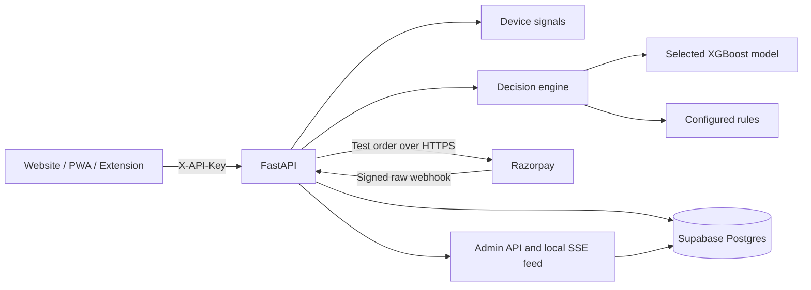

# FraudLens backend

FraudLens is a fraud decision gateway for student demos. A merchant registers device signals, requests a decision before payment, creates a Razorpay test-mode order only for an allowed or reviewer-approved check, and receives signed payment updates by webhook.

## Architecture



The API uses Supabase's server-side service key. RLS is enabled and has no public policies. Never send `SUPABASE_KEY` or the service role key to a browser, PWA, extension, or frontend build. Apply migrations `001`, `003`, `004`, `005`, `006`, `007`, `008`, and `009` from [migrations](migrations/README.md) in that order. Migration `002` is the optional manual merchant seed.

## Quick start

From the repository root in PowerShell:

```powershell
conda activate fraudenv
python -m pip install -r backend/requirements.txt
python ml/src/train_live.py --synthetic-rows 30000
Push-Location backend
python -m pytest -q tests
Pop-Location
Copy-Item backend/.env.example backend/.env
```

Fill `backend/.env` locally with server credentials. Do not commit it. Set `MODEL_VERSION=xgb_live_v1` to run the live-feature model; `xgb_creditcard_v1` is the compatibility fallback. Run locally:

```powershell
Push-Location backend
python -m uvicorn main:app --reload --port 8000 --no-proxy-headers
Pop-Location
```

Create a merchant after migrations and Supabase configuration are ready:

```powershell
python scripts/create_merchant.py --name "FraudLens Demo"
```

The script prints the merchant API key once. Save it privately; the database stores only its SHA-256 hash. Do not put the key in source control, a public frontend, or a support message.

## API reference

The detailed frontend contract is in [docs/api-contract.md](../docs/api-contract.md). All decision amounts are INR rupees; Razorpay orders are sent in paise.

| Endpoint | Authentication | Purpose |
|---|---|---|
| `GET /health` | None | Model and database health |
| `POST /v1/signals` | `X-API-Key` | Register device and user association |
| `POST /v1/checks` | `X-API-Key`, `Idempotency-Key` | Return `ALLOW`, `REVIEW`, or `BLOCK` |
| `POST /v1/payments/order` | `X-API-Key`, `Idempotency-Key` | Create an eligible Razorpay order |
| `POST /v1/payments/verify` | `X-API-Key` | Verify Checkout's HMAC callback |
| `POST /v1/webhooks/razorpay` | `X-Razorpay-Signature` | Receive signed Razorpay events |
| `GET /v1/admin/reviews` | `Authorization: Bearer …` | List pending/reviewed cases |
| `POST /v1/admin/reviews/{check_id}` | `Authorization: Bearer …` | Resolve a review and label feedback |
| `GET /v1/admin/stats` | `Authorization: Bearer …` | Decision counts, rules, latency, hourly totals |
| `GET /v1/admin/evaluation` | `Authorization: Bearer …` | Compare labeled checks with decisions |
| `GET /v1/admin/feed` | `Authorization: Bearer …` | SSE stream of new checks |
| `POST /predict` | `X-API-Key` | Legacy prediction API |
| `GET /history/{user_id}` | `X-API-Key` | Legacy transaction history |
| `GET /stats` | `Authorization: Bearer …` | Legacy transaction statistics |

Core requests and responses:

```http
POST /v1/signals
X-API-Key: <merchant-key>
Content-Type: application/json
```

```json
{"device_id":"install-42","user_id":"user-42","platform":"web","user_agent":"Mozilla/5.0 ...","screen":{"width":1440,"height":900,"pixel_ratio":2},"timezone":"Asia/Kolkata","language":"en-IN"}
```

```json
{"device_id":"install-42","first_seen":"2026-11-16T10:00:00+00:00","last_seen":"2026-11-16T10:00:00+00:00","trust_score":50}
```

```http
POST /v1/checks
X-API-Key: <merchant-key>
Idempotency-Key: <operation-id>
Content-Type: application/json
```

```json
{"user_id":"user-42","device_id":"install-42","amount":1250.5,"currency":"INR","payment_method":"upi"}
```

```json
{"check_id":"00000000-0000-0000-0000-000000000001","decision":"ALLOW","final_score":7.5,"ml_score":2.5,"rule_score":15,"reasons":[{"rule":"NEW_DEVICE","detail":"first transaction from device install-42","weight":15}],"model_version":"xgb_live_v1","ml_factors":[{"feature":"amount","contribution":0.2}],"latency_ms":18}
```

```http
POST /v1/payments/order
X-API-Key: <merchant-key>
Idempotency-Key: <operation-id>
Content-Type: application/json
```

```json
{"check_id":"00000000-0000-0000-0000-000000000001"}
```

```json
{"order_id":"order_test_example","amount":125050,"currency":"INR","key_id":"rzp_test_public_key_id"}
```

Checkout verification sends `razorpay_order_id`, `razorpay_payment_id`, and `razorpay_signature` to `/v1/payments/verify` with `X-API-Key`. The response is `{ "order_id": "…", "payment_id": "…", "status": "authorized" }`. Razorpay webhooks POST the provider JSON to `/v1/webhooks/razorpay` with `X-Razorpay-Signature`; a valid event gets `{ "received": true, "duplicate": false }`.

For every admin endpoint, send `Authorization: Bearer <ADMIN_TOKEN>`. Review decisions use `POST /v1/admin/reviews/{check_id}` with `{"outcome":"approve","reviewer":"analyst-1","note":"Verified"}`; it returns the check id, outcome, reviewer, and feedback label. The review queue returns check rows with reasons. Stats and evaluation return their aggregate fields. `/v1/admin/feed` streams `event: check` records and 15-second keepalive comments. The [API contract](../docs/api-contract.md) documents every endpoint, headers, validation bounds, response fields, errors, and client signal collection in full.

All errors use `{ "error": { "code": "...", "message": "..." }, "request_id": "..." }`. Validation failures return `422`; authentication `401`; authorization `403`; missing records `404`; state conflicts `409`; rate limits `429` with `Retry-After`; upstream Razorpay failures `502`; unavailable configuration/storage `503`; unexpected errors `500`. Validation messages do not echo submitted bodies.

### Decision logic

The score is `0.6 × ML score + 0.4 × rule score`, with both scores on a 0–100 scale. A hard rule forces at least `REVIEW`. Otherwise `<30` is `ALLOW`, `30–59.99` is `REVIEW`, and `>=60` is `BLOCK`.

| Rule | Weight | Trigger summary | Hard |
|---|---:|---|---|
| `HIGH_AMOUNT` | 25 | Amount above ₹100,000 | No |
| `STRUCTURING` | 35 | 3+ transactions from ₹90,000–₹100,000 in 24 hours | Yes |
| `VELOCITY` | 30 | 4+ checks in 15 minutes | No |
| `IMPOSSIBLE_TRAVEL` | 40 | More than 1,000 km/h across at least 50 km | Yes |
| `NEW_DEVICE` | 15 | Device not present in this user's check history | No |
| `ODD_HOUR` | 10 | Local device time from 00:00 through 04:59 | No |
| `SHARED_DEVICE` | 25 | Device linked to 3+ users | No |
| `FAILED_PAYMENT_BURST` | 30 | 3+ failed payments in 10 minutes | No |
| `AMOUNT_SPIKE` | 30 | Current amount above 5× the mean of up to 20 prior checks, with at least 5 checks | No |
| `NEW_USER_HIGH_VALUE` | 20 | First check above ₹50,000 | No |
| `GEO_DEVICE_MISMATCH` | 20 | Disabled by default; optional location/time-zone heuristic | No |
| `TRUSTED_DEVICE_DISCOUNT` | -10 | Device at least 30 days old with 5 clean decisions | No |

Weights and thresholds are demonstration heuristics until evaluated against reviewed or otherwise representative outcomes. `rules_config.json` is the source of rule weights and thresholds.

## Security and data handling

- Keep Supabase's service key, Razorpay key secret, webhook secret, and admin token on the server only.
- Razorpay credentials must be test keys unless `ENV=prod` is explicitly set. Use test mode for this demo.
- The client should send only a device id, platform, user agent, screen size, time zone, language, and optional location. Never send card number, CVV, UPI address, or payment instrument details to FraudLens.
- The payment database stores check/order/payment ids, amount, status, and timestamps. Webhook storage keeps the event id/type only, not the raw body.
- CORS is configured by `ALLOWED_ORIGINS`; include exact site origins and, for an extension, its `chrome-extension://<id>` origin. CORS is not authentication.
- A merchant API key embedded in JavaScript or a browser extension can be extracted. Direct browser use is acceptable for a controlled student demo; production integrations should call FraudLens through a merchant-owned server proxy or use a separate short-lived public-client credential design.
- API rate limiting is process-local: 60 checks/minute and 10 payment order/verify requests/minute per merchant and per IP. It resets on process restart and does not coordinate multiple instances.
- The SSE feed is process-local and is intended for one Render instance. It does not replay events after a client reconnects.

## Razorpay test mode

See [RAZORPAY_TESTING.md](RAZORPAY_TESTING.md) for official test card and UPI values, local webhook signing, and tunnel instructions. `httpx` is used instead of the Razorpay SDK because it is already installed and keeps the dependency set smaller.

## Render deployment

The service definition is in [render.yaml](render.yaml). To deploy through the Render dashboard:

1. Apply the Supabase migrations and create a merchant. Keep the service key and the displayed merchant key private.
2. Connect the Git repository and select branch `main`.
3. Create a **Web Service**, choose Python, and select the **Free** instance for the demo.
4. Set **Root Directory** to `backend`.
5. Set **Build Command** to `pip install -r requirements.txt`.
6. Set **Start Command** to `uvicorn main:app --host 0.0.0.0 --port $PORT`.
7. Add these environment variables in the Render dashboard. Set secret values in the dashboard's secret fields; do not put them in `render.yaml`.

| Variable | Dashboard value |
|---|---|
| `PYTHON_VERSION` | `3.11.18` |
| `SUPABASE_URL` | Supabase project URL |
| `SUPABASE_KEY` | Supabase service role key; server only |
| `RAZORPAY_KEY_ID` | Test key id beginning `rzp_test_` |
| `RAZORPAY_KEY_SECRET` | Razorpay test key secret |
| `RAZORPAY_WEBHOOK_SECRET` | Secret configured for the Razorpay webhook |
| `ALLOWED_ORIGINS` | Comma-separated exact origins, including extension origin if needed |
| `TRUSTED_PROXY_IPS` | Verified proxy IPs or CIDRs allowed to supply forwarded client IPs; leave empty until known |
| `ADMIN_TOKEN` | A long random bearer token |
| `ENV` | `dev` for a test-mode deployment |
| `MODEL_VERSION` | `xgb_live_v1` for live-computable features; `xgb_creditcard_v1` for fallback |

8. Deploy and check `https://<service>.onrender.com/health`. Require `status=ok`, `model_loaded=true`, and `db_reachable=true`.
9. Keep the merchant key on a merchant backend for any real integration. For a controlled demo, a browser key is extractable and should be treated as disposable. Run `scripts/smoke_test.py` with the deployed URL and merchant key configured in the local `FRAUDLENS_API_KEY` environment variable.
10. In Razorpay Dashboard Test Mode, register `https://<service>.onrender.com/v1/webhooks/razorpay`, subscribe to the four supported payment events, and configure the same webhook secret as the server.

After deployment, verify a check, inspect its decision and reasons, create a test order only when eligible, and confirm a signed webhook changes its payment status. Use the webhook testing guide for details. The Uvicorn start command disables automatic proxy-header trust. `TRUSTED_PROXY_IPS` controls which direct peers may supply `X-Forwarded-For` or `CF-Connecting-IP`; an empty value uses the direct peer address. Confirm the Render proxy address before setting it.

### Free-tier behavior and keep-alive

Render currently lists 512 MB RAM for the free web service. Free services spin down after 15 minutes without incoming traffic and commonly take about a minute to wake. A `cron-job.org` job that GETs `/health` every 10 minutes can reduce idle spin-down when it runs reliably; it is not an uptime guarantee and a failed/late ping can still lead to a cold start. Free Render is intended for demos and hobby projects, not production payment decisions. See [Render free instance limits](https://render.com/docs/free) and [current compute pricing](https://render.com/pricing).

Measured locally on macOS with Python 3.11 after importing the FastAPI app and loading one model, peak RSS was **158.4 MiB** for `xgb_creditcard_v1` and **148.1 MiB** for `xgb_live_v1`. This is a local startup measurement, not a Render measurement; request peaks and platform overhead may differ.

## Tests and demo traffic

```powershell
conda activate fraudenv
Push-Location backend
python -m pytest -q tests
Pop-Location
```

The suite includes rule trigger/non-trigger tests, decision thresholds, auth/rate-limit/idempotency tests, webhook signature/replay cases, admin cases, and mocked payment/Supabase integration.

Run one demo scenario from the repository root with the merchant key available in the local `FRAUDLENS_API_KEY` environment variable:

```powershell
python scripts/simulate_traffic.py --scenario structuring --platform web
python scripts/simulate_traffic.py --scenario impossible_travel --platform mobile
python scripts/simulate_traffic.py --scenario shared_device --platform extension
```

Scenarios are `normal`, `structuring`, `velocity`, `impossible_travel`, `shared_device`, `night_high_value`, and `all`. `night_high_value` triggers `ODD_HOUR` only when server time in `Asia/Kolkata` is between midnight and 04:59; otherwise it still tests the high-value rules.

After deployment, run:

```powershell
python scripts/smoke_test.py https://<service>.onrender.com
```

The smoke test expects both an `ALLOW` and `BLOCK`. For a repeatable block demonstration, select `MODEL_VERSION=xgb_live_v1`; the old credit-card model has near-flat live scores because its PCA features are unavailable.

## Honest limitations

- The live model was trained on synthetic data because no PaySim dataset was present. The reported synthetic metrics are not real-world accuracy.
- The older Kaggle credit-card model expects PCA columns that cannot be computed from device/payment signals, so its live score is weak. It remains as a compatibility fallback.
- Rule weights, decision thresholds, and the synthetic live model require evaluation with representative, consented outcomes. The evaluation endpoint only measures labeled cases that exist so far.
- The API is a fraud decision layer and test-mode integration, not a payment processor. No live payment, Supabase production project, or Render deployment was exercised in the local test suite.
- The current admin feed, rate limiter, and merchant-key approach have single-instance/demo constraints described above.
- Saved check `latency_ms` covers context loading and scoring before persistence. The `Server-Timing` header and request logs measure the full API response path. Admin stats are cached for at most five seconds per process and report p95 of saved scoring latency.
- Do not treat `ALLOW` as a guarantee of safety or `BLOCK` as a verified fraud finding.
